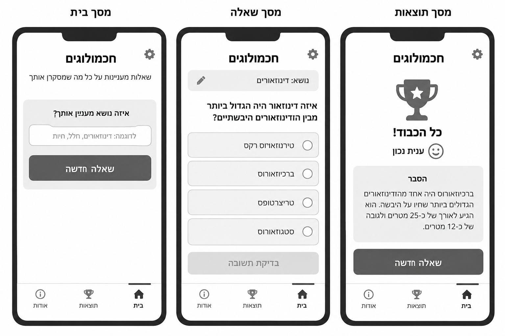
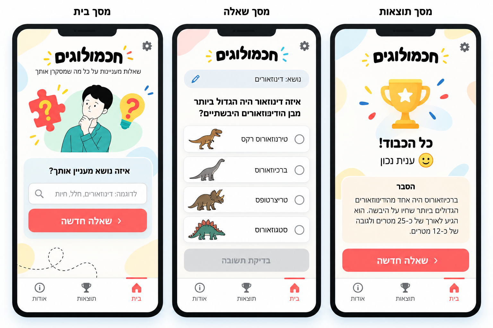
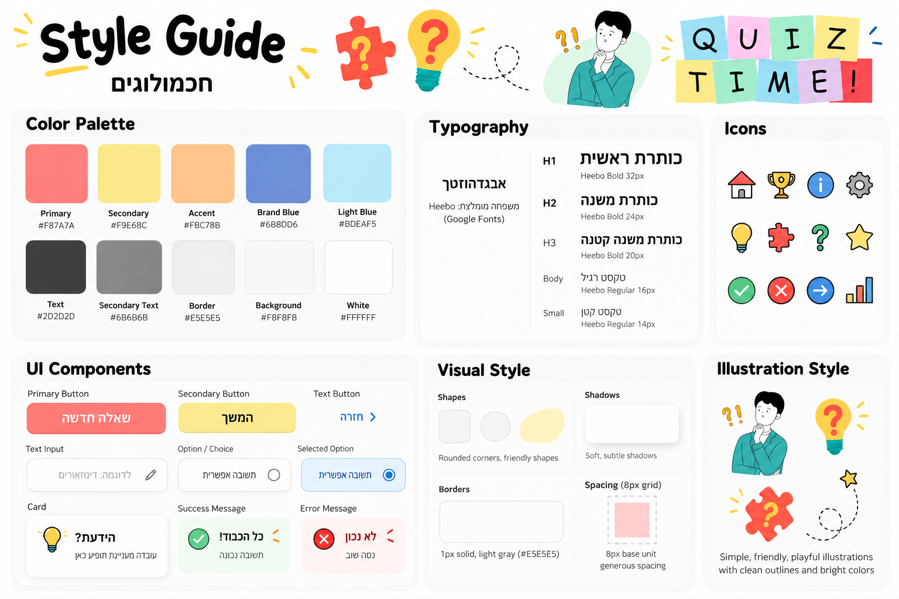

# DESIGN — חכמולוגים

מסמך עיצוב ממשק עבור אפליקציית הטריוויה לילדים. ה-PRD קובע את היקף המוצר וההתנהגות; התמונות מספקות ייחוס למבנה ולשפה החזותית, בכפוף להערת ההתאמה להלן.

## 1. Screens – מסכי האפליקציה

### מקורות חזותיים

**Wireframes – מבנה ראשוני**

**Mockups – מראה מעוצב**

> **הבהרת התאמה מהותית:** התמונות שנוצרו קודם מציגות שלוש תצוגות בשם "מסך בית", "מסך שאלה" ו"מסך תוצאות". אולם ה-PRD מאשר שלושה מסכים אחרים: **בית, טריוויה ואודות**. לפיכך, "מסך שאלה" ו"מסך תוצאות" הם מצבים של **אותו מסך טריוויה**, ולא עמודים נפרדים. מסך אודות חסר בתמונות. גם אייקון הגדרות, ניווט ל"תוצאות", כפתור "בדיקת תשובה" והצגת הסבר עובדתי לאחר מענה אינם דרישות מאושרות. אין לממשם כיכולות חדשות. התמונות משמשות השראה חזותית בלבד במקומות שבהם הן סותרות את ה-PRD.

### 1.1 מסך הבית — "בית"

**מטרה:** נקודת כניסה ידידותית למשחק.

**מבנה ותוכן:** כותרת בולטת "חכמולוגים" בראש המסך; מתחתיה שורת משנה "שאלות מעניינות על כל מה שמסקרן אתכם" (במסך הבית בלבד); אזור איור מרכזי בנושא טריוויה (דמות סקרנית, סימן שאלה, נורה ופאזל, לפי ה-Mockups; מקור האיור בסעיף 2.6); כפתור ראשי גדול "בואו נשחק!"; סרגל ניווט תחתון קבוע. שדה הזנת נושא המופיע בתמונת ה-Wireframes של הבית שייך לפי ה-PRD **למסך הטריוויה** בלבד, ולכן לא יוצג בבית.

**פעולות וניווט:** לחיצה על "בואו נשחק!" או על "טריוויה" בסרגל מעבירה למסך הטריוויה; "אודות" מעביר למסך אודות.

### 1.2 מסך הטריוויה — "טריוויה"

**מטרה:** בחירת נושא, יצירת שאלה, מענה וקבלת משוב באותה תצוגה.

**מבנה ותוכן:** שדה קלט נושא בראש אזור התוכן (עם תווית גלויה); מתחתיו כפתור ראשי "שאלה חדשה"; לאחר יצירה, כותרת שאלה בולטת וארבע אפשרויות תשובה בכרטיסים אנכיים מעוגלים עם אזור בחירה ברור. השאלה והאפשרויות ב-Mockups משמשות דוגמה לסידור בלבד. לאחר בחירה אחת מוצג מתחת לתשובות כרטיס משוב צבעוני, עם הדגשת התשובה הנכונה במקרה של טעות, ומתחתיו כפתור "שאלה חדשה" נוסף (אותה פעולה בדיוק, כדי שלא יהיה צורך לגלול למעלה בטלפון). סרגל הניווט נשאר בתחתית.

**טבלת מצבי מסך הטריוויה:**

| מצב | מה מוצג | כפתור "שאלה חדשה" | כרטיסי תשובה |
|---|---|---|---|
| התחלה, התיבה ריקה | תיבת נושא וכפתור | מושבת | — |
| התחלה, יש טקסט בתיבה | תיבת נושא וכפתור | פעיל | — |
| טעינה (שאלה ראשונה) | אנימציית טעינה והטקסט "מכינים לך שאלה מעניינת..." מתחת לכפתור | מושבת | — |
| טעינה (כבר מוצגת שאלה) | השאלה הקודמת מעומעמת ונעולה, אנימציית הטעינה מעליה | מושבת | נעולים |
| שאלה פעילה | שאלה וארבע תשובות | פעיל (מאפשר דילוג) | פעילים |
| אחרי מענה | הדגשת נכון/שגוי, כרטיס משוב, כפתור "שאלה חדשה" נוסף | פעיל | נעולים |
| שגיאה | השאלה הקודמת (אם הייתה), ומתחתיה כרטיס שגיאה עם "נסו שוב" | פעיל | כפי שהיו לפני הבקשה |
| נושא נחסם | כרטיס הודעה ידידותי לבחירת נושא אחר; הנושא נשאר בתיבה | פעיל | השאלה הקודמת (אם הייתה) |

"נסו שוב" שולח שוב את אותה בקשה בדיוק (אותו נושא). Enter בתיבת הנושא פועל כמו לחיצה על "שאלה חדשה".

**מצבי אותו מסך (לא מסכים נוספים):** לפני שאלה; טעינה עם אנימציה קטנה וההודעה "מכינים לך שאלה מעניינת..."; שאלה פעילה; משוב הצלחה או טעות; תקלה עם "נסו שוב"; נושא שנחסם בסינון התוכן עם בקשה לבחור נושא אחר (פירוט בטבלה למעלה). שינוי טקסט בשדה הנושא אינו מחליף את השאלה עד לחיצה על כפתור יצירת שאלה. אין כפתור אישור תשובה נפרד: בחירה בתשובה מפעילה את המשוב בהתאם ל-PRD.

**פעולות וניווט:** הזנת נושא; יצירת שאלה; בחירת תשובה אחת בלבד; יצירת שאלה נוספת באותו נושא או בנושא אחר; מעבר לבית ולאודות דרך הסרגל.

### 1.3 מסך אודות — "אודות"

**מטרה:** הסבר קצר ופשוט לילדים על השימוש במשחק.

**מבנה ותוכן:** כותרת "אודות" ואזור תוכן קריא וקצר המסביר מהי חכמולוגים, כיצד בוחרים נושא, כיצד עונים וכיצד ממשיכים לשאלה הבאה. כרטיס תוכן מעוגל בסגנון ה-Style Guide, ללא אזור מידע להורים וללא רכיבים אינטראקטיביים חדשים. סרגל ניווט תחתון קבוע. למסך זה **אין Mockup ייעודי בתמונות המקור**; העיצוב יאמץ את סגנון הכרטיסים, הטיפוגרפיה והריווח מה-Style Guide.

**פעולות וניווט:** מעבר לבית או לטריוויה דרך סרגל הניווט.

### ניווט כללי

שלושה יעדי ניווט קבועים בלבד, בסדר מימין לשמאל: **"בית"** (אייקון בית), **"טריוויה"** (אייקון סימן שאלה, במקום שבו מופיע גביע "תוצאות" בתמונות), **"אודות"** (אייקון i בעיגול). לכל יעד אייקון ותווית, והיעד הפעיל מסומן בצבע ובקו עליון כמו בתמונות. הסרגל ממוקם בתחתית בכל המסכים. **אין יעד "תוצאות"**: תוצאות המענה מוצגות בתוך מסך הטריוויה.

**כותרת עליונה:** הלוגו-טקסט "חכמולוגים" מופיע בראש כל שלושת המסכים, כמו בתמונות. אין אייקון הגדרות.

### 1.4 טקסטים בממשק

כל הטקסטים בלשון רבים או בלשון ניטרלית. אלה הנוסחים המחייבים:

| מקום | טקסט |
|---|---|
| כותרת האפליקציה | חכמולוגים |
| שורת משנה (בית) | שאלות מעניינות על כל מה שמסקרן אתכם |
| כפתור במסך הבית | בואו נשחק! |
| תווית תיבת הנושא | איזה נושא מעניין אתכם? |
| טקסט רמז בתיבה | לדוגמה: דינוזאורים, חלל, חיות |
| כפתור יצירת שאלה | שאלה חדשה |
| טעינה | מכינים לך שאלה מעניינת... |
| תשובה נכונה | כל הכבוד! תשובה נכונה |
| תשובה שגויה | לא נורא! התשובה הנכונה מסומנת בירוק |
| נושא נחסם (`UNSAFE_TOPIC`) | בואו נבחר נושא אחר 🙂 את הנושא הזה לא נוכל לשאול עליו. |
| תקלה (`GENERATION_FAILED`, `SERVICE_UNAVAILABLE`) | אופס! לא הצלחנו להכין שאלה הפעם. |
| תשובה מתעכבת (`GENERATION_TIMEOUT`, `CLIENT_TIMEOUT`) | השאלה התעכבה קצת יותר מדי. |
| עומס (`TEMPORARILY_BUSY`) | יש עכשיו הרבה שאלות בדרך. נחכה רגע? |
| אין אינטרנט (`NETWORK_ERROR`) | נראה שאין חיבור לאינטרנט. בדקו את החיבור. |
| נושא לא תקין (`INVALID_TOPIC`) | כתבו נושא כדי שנוכל להכין שאלה. |
| כפתור בכרטיס שגיאה | נסו שוב |
| תוויות הסרגל | בית · טריוויה · אודות |

"נסו שוב" מופיע **רק** במצבי תקלה, ולעולם לא אחרי תשובה שגויה (בניגוד לתמונת ה-Style Guide).

**טקסט מסך אודות:**

> **מה זה חכמולוגים?**
> משחק שאלות על כל מה שמעניין אתכם!
>
> 1. כתבו נושא שאתם אוהבים, למשל חיות, חלל או כדורגל.
> 2. לחצו על "שאלה חדשה" וחכו רגע.
> 3. בחרו תשובה אחת מתוך ארבע.
> 4. ירוק? צדקתם! אדום? לא נורא, התשובה הנכונה תסומן בירוק.
> 5. רוצים עוד? לחצו שוב על "שאלה חדשה", באותו נושא או בנושא חדש.
>
> את השאלות כותב מחשב חכם, ולפעמים גם הוא טועה. אם משהו נראה לכם מוזר, שאלו מבוגר 🙂

## 2. Style Guide – השפה העיצובית

### 2.1 Color Palette

הערכים להלן נלקחו מתמונת ה-Style Guide, ולא נגזרו מצבעי צילום ה-Inspiration Board:

| תפקיד | HEX | שימוש |
|---|---|---|
| Primary | `#F87A7A` | פעולות ראשיות, הדגשות ורכיבים מרכזיים |
| Secondary | `#F9E68C` | כפתורים משניים, אלמנטים שמחים ורקע משלים |
| Accent | `#FBC78B` | הדגשות מאוירות ורקע עדין |
| Brand Blue | `#6B8DD6` | מצב בחירה, קישורים והדגשות משניות |
| Light Blue | `#BDEAF5` | רקעים רכים לשדות ולכרטיסים |
| Text | `#2D2D2D` | טקסט ראשי |
| Secondary Text | `#6B6B6B` | טקסט משני ותוויות |
| Border | `#E5E5E5` | קווי הפרדה וגבולות |
| Background | `#F8F8F8` | רקע כללי |
| White | `#FFFFFF` | משטחי כרטיסים ושדות |

**צבעים משלימים לנגישות ולמצבים** (נוספו כי חלק מצבעי ה-Style Guide לא מספיק קריאים כרקע לטקסט לבן או כצבע טקסט, ומצבי הצלחה/שגיאה לא הוגדרו במקור):

| תפקיד | HEX | שימוש |
|---|---|---|
| Primary Strong | `#E35D5D` | מילוי כפתור ראשי (טקסט לבן מודגש בגודל 20px לפחות; ניגודיות כ-3.5:1) |
| Primary Text | `#D13F3F` | טקסט ואייקון של היעד הפעיל בסרגל (ניגודיות כ-4.7:1 על לבן) |
| Link Blue | `#3F64B5` | טקסט כחול: Text Button וטקסט התשובה הנבחרת (ניגודיות כ-5.7:1 על לבן) |
| Success | `#2E9E5B` | מסגרת ואייקון של תשובה נכונה ומשוב הצלחה |
| Success Background | `#E8F7EE` | רקע תשובה נכונה וכרטיס הצלחה |
| Error | `#D93B3B` | מסגרת ואייקון של תשובה שגויה ושגיאות |
| Error Background | `#FDECEC` | רקע תשובה שגויה וכרטיס שגיאה |

`Primary` (`#F87A7A`) נשאר לשימושים דקורטיביים: הדגשות, אייקונים ואיורים, ולא כרקע לטקסט לבן קטן. טקסט בתוך כרטיסי משוב הוא בצבע `Text`. יש להשתמש גם באייקון ובטקסט, לא בצבע בלבד.

### 2.2 Typography

- **משפחת גופנים:** `Heebo` (Google Fonts), עם fallback לגופן Sans-serif התומך בעברית.
- **H1:** `Heebo Bold`, ‏32px — כותרת מסך או כותרת מרכזית.
- **H2:** `Heebo Bold`, ‏24px — כותרת משנה או שאלה בולטת.
- **H3:** `Heebo Bold`, ‏20px — כותרת אזור/כרטיס.
- **Body:** `Heebo Regular`, ‏16px — טקסטים, תשובות והסברים.
- **Small:** `Heebo Regular`, ‏14px — תוויות וטקסט משני.
- כותרת המותג "חכמולוגים" במוקאפ נראית עבה ומשחקית במיוחד; אין במקור זיהוי של משפחת גופן נוספת, ולכן אין לקבוע גופן מותג אחר כדרישה.

### 2.3 UI Style

- **Primary Button:** כפתור גדול (גובה 56px לפחות), מעוגל ובולט במילוי `Primary Strong`, טקסט לבן מודגש בגודל 20px. במצב מושבת: רקע `Border` וטקסט `Secondary Text`. לא נדרש Gradient.
- **Secondary Button:** מילוי צהוב בהיר (`Secondary`), טקסט כהה ופינות מעוגלות. משמש לכפתור "נסו שוב" בכרטיסי שגיאה.
- **Text Button:** טקסט בצבע `Link Blue` עם אייקון כיווני לפי הצורך.
- **Text Input:** משטח לבן, מסגרת אפורה דקה, פינות מעוגלות וטקסט/Placeholder מיושרים לימין. במצב Focus: מסגרת `Brand Blue` בעובי 2px.
- **Answer Option:** כרטיס לבן עם מסגרת עדינה, ריווח נדיב, גובה 56px לפחות, טקסט מימין ועיגול בחירה כמו ב-Style Guide. מצבים:
  - **רגיל:** לבן, מסגרת `Border`.
  - **תשובה נכונה (אחרי מענה):** רקע `Success Background`, מסגרת `Success` בעובי 2px, אייקון ✓ בעיגול ירוק.
  - **התשובה שנבחרה ושגויה:** רקע `Error Background`, מסגרת `Error` בעובי 2px, אייקון ✗ בעיגול אדום.
  - **שאר התשובות אחרי מענה:** אטימות מופחתת (כ-60%), לא לחיצות.
- **Cards:** משטחים לבנים או בגוני פסטל בהירים, פינות מעוגלות וצל רך.
- **Feedback:** כרטיס או אזור משוב עם אייקון הצלחה/שגיאה, הודעה ידידותית והדגשת התשובה הנכונה במקרה הצורך.
- **Navigation:** סרגל תחתון לבן עם אייקון ותווית לכל אחד משלושת היעדים; היעד הפעיל מודגש בצבע `Primary Text` ובקו עליון. אייקונים: בית, סימן שאלה, i בעיגול.
- **Loading:** שלוש נקודות קופצות בצבעי `Primary`, `Secondary` ו-`Brand Blue`, לצד הטקסט "מכינים לך שאלה מעניינת...". למשתמשים שביקשו להפחית תנועה במכשיר (`prefers-reduced-motion`) הנקודות מהבהבות בעדינות במקום לקפוץ.
- **Icons:** איורים ואייקונים פשוטים, קריאים, צבעוניים ובעלי קווי מתאר ברורים; סימני שאלה, נורה ופאזל מתאימים למוטיב החידון.

### 2.4 Visual Style

- **אווירה:** שמחה, סקרנית, קלילה ונגישה לילדים, עם צבעי פסטל בהירים והדגשות רוויות במידה.
- **צורות:** מלבנים מעוגלים, עיגולים, כתמי צבע רכים וצורות חופשיות עדינות.
- **פינות:** מעוגלות באופן בולט: `16px` לכפתורים, לכרטיסים ולכרטיסי תשובה; `12px` לשדה קלט.
- **Borders:** קו דק, לרוב `1px` בצבע `#E5E5E5`.
- **Shadows:** צל רך אחיד לכרטיסים ולכפתורים: `0 2px 8px rgba(0, 0, 0, 0.08)`.
- **Spacing:** מערכת בסיס של `8px` ומרווחים נדיבים בין רכיבים וקבוצות.
- **Layout:** Mobile-first, פריסה אנכית, אזורי תוכן ברורים, כפתורים גדולים, כרטיסי תשובות בגובה נוח למגע וסרגל ניווט תחתון קבוע. בטאבלט ובמחשב התוכן ממורכז ברוחב מקסימלי של `480px`, כדי לא למתוח שורות תשובה לרוחב לא נוח; הסרגל התחתון נפרש לכל הרוחב.
- **Illustrations:** איורים שטוחים, ידידותיים ופשוטים, עם קווי מתאר נקיים וצבעים בהירים; דמות חושבת, נורות, פאזלים וסימני שאלה. אין להשתמש בתמונות Stock עם סימני מים. איורי דינוזאורים לצד כל תשובה מופיעים במוקאפ כדוגמה חזותית, אך אינם דרישה לכל שאלה שנוצרת דינמית.
- **רקע:** בהיר ונקי, עם נגיעות פסטל לא פולשניות סביב אזורי התוכן.

### 2.5 שפה וכיווניות

- כל תוכן ה-UI בעברית בלבד ובכיווניות `RTL`.
- כותרות, שדות קלט, טקסטי תשובות והודעות מיושרים לימין כברירת מחדל; רכיבים מרכזיים כגון כפתור פתיחה ואיור יכולים להיות ממורכזים.
- סדר אייקון/תווית ורכיבי בחירה צריך להיות עקבי ב-RTL. סמלי כיוון צריכים להתאים לכיוון המעבר בפועל.
- שמות הקטגוריות המקצועיות במסמך נשארים באנגלית, אך אינם טקסט המיועד להצגה בממשק.

### 2.6 קובצי איור ואייקונים

התמונות ב-`spec/` הן הדמיות בלבד, ואין בהן קובצי איור נפרדים לשימוש באפליקציה.

- **איור מסך הבית:** `public/images/home-illustration.png` (רקע שקוף, רוחב 800px לפחות). המשתמש יכול לספק קובץ כזה בכל שלב, למשל מכלי AI ליצירת תמונות, בסגנון של ה-Style Guide. עד אז, ב-Milestones 1–3 משמש איור זמני פשוט (SVG) שמורכב מסימן שאלה, נורה ופאזל בצבעי הפלטה. אם עד Milestone 4 לא סופק קובץ, האיור הזמני נשאר.
- **אייקון האפליקציה (PWA):** `public/icons/icon-192.png`, `public/icons/icon-512.png` וגרסת Maskable. ייווצר ב-Milestone 4 כסימן שאלה לבן על רקע עגול בצבע `Primary Strong`, אלא אם המשתמש סיפק אייקון משלו.
- **אייקוני ממשק** (בית, סימן שאלה, i, ✓, ✗): אייקוני SVG פשוטים בתוך הקוד, בלי ספריית אייקונים חיצונית.
